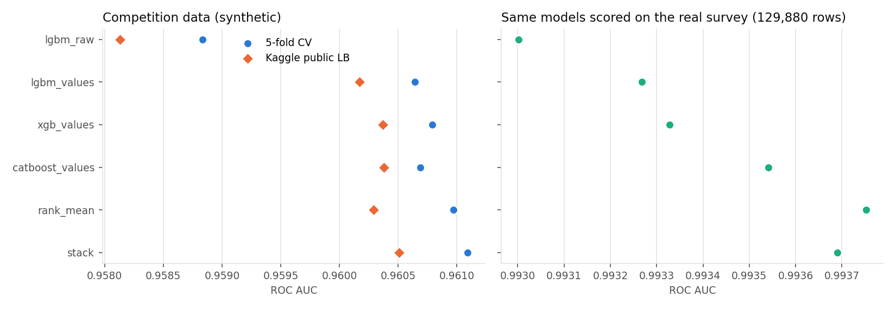
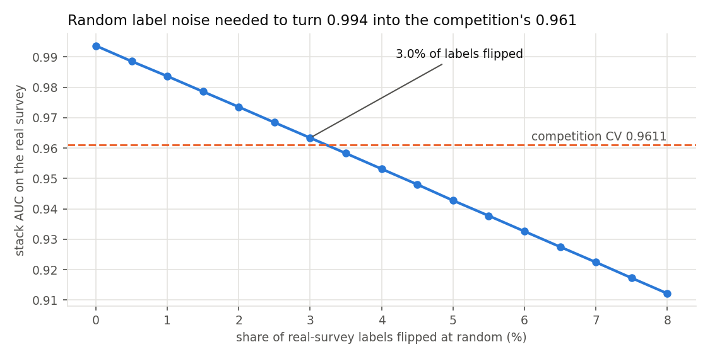
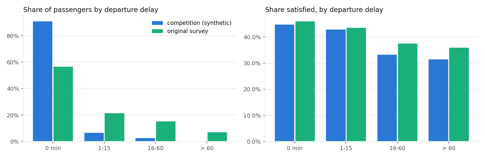

**English** | [Español](README.es.md)

# Airline satisfaction: a 0.961 leaderboard that is really a 0.994 model


Kaggle [Playground Series S6E10, Predicting Airline Satisfaction](https://www.kaggle.com/competitions/playground-series-s6e10):
699,635 passengers with a label, 299,844 to score, ranked by ROC AUC. The rows are
synthetic. They were generated from a real survey of 129,880 US airline passengers
([Airline Passenger Satisfaction](https://www.kaggle.com/datasets/teejmahal20/airline-passenger-satisfaction)).

I built the usual competition pipeline: five models, 5-fold CV, two blends and seven
submissions made from one run. Then I scored every model on the **real** survey too. The models
are much better than the leaderboard shows. A stack that scores 0.961 on the competition
scores **0.994 on the real passengers**, and that gap behaves like about 3% of the competition's
labels being flipped at random.

**Best Kaggle public score: 0.96051** (stack of four boosted models; CV 0.96109). Rank
1,192 of 2,914 teams on 2026-10-24. The leader is at 0.96407 and the median team at
0.95959.

**Project page:** https://rxyxs.github.io/airline-satisfaction-kaggle/

## Results

All seven files came from one run and were submitted together. Nothing was tuned on the
leaderboard. "Real survey" means the 129,880 original passengers. The models never trained on
them, and each number is the average prediction of the five fold models.

| Submission | 5-fold CV | Kaggle public | Real survey |
|---|---|---|---|
| Logistic regression (one-hot, scaled) | 0.92156 | 0.92227 | 0.92000 |
| LightGBM, the 21 columns as given | 0.95884 | 0.95813 | 0.99300 |
| LightGBM + value features | 0.96064 | 0.96017 | 0.99327 |
| XGBoost (GPU) + value features | 0.96079 | 0.96037 | 0.99333 |
| CatBoost (GPU), every column also as a category | 0.96069 | 0.96038 | 0.99354 |
| Rank mean of the four tree models | 0.96097 | 0.96029 | 0.99375 |
| **Logistic stack of the four tree models** | **0.96109** | **0.96051** | 0.99369 |

Fold-to-fold standard deviation is 0.0004-0.0005 for every tree model. CV and the public
leaderboard agree to within 0.0007 and rank the models in nearly the same order.



## Findings

**1. The competition labels look about 3% noisier than the real ones.** A model trained only
on synthetic rows ranks real passengers almost as well (0.9937) as a LightGBM trained on the real
survey and scored on a held-out 20% of it (0.9950). The structure is in the synthetic
data. What caps the score is the labels. I flipped a random share of the real-survey labels and
re-scored the stack. With 3.0% flipped, its AUC on real passengers is 0.963. With 3.5%
flipped, it is 0.958. The competition CV of 0.961 lies between the two, so the synthetic labels
behave like **about 3% random flips**. Seen this way, the whole leaderboard is packed against a
noise floor. The top team is 0.0036 above my stack and the median team 0.0009 below it.



**2. Treating values as categories is worth +0.0018, and it is not just a synthetic artifact.**
The "value" models see each exact value (and each pair of columns' values) as a category,
through out-of-fold target encoding or CatBoost's own categorical handling. This lifts CV from
0.9588 to 0.9606-0.9608 and the public score from 0.9581 to 0.9602-0.9604. My guess was that
these models were learning quirks of the generator, which would hurt on real data. They don't. They
also score higher on the real survey (0.9930 to 0.9933-0.9935).

**3. Adding the real survey as training rows does not help.** Appending all 129,880 original
passengers to every training fold moves CV from 0.95884 to 0.95866. The generator changed the
data enough that the real rows are a different distribution. 91% of synthetic passengers
left on time, against 56% in the survey. Late-flight satisfaction is lower in the synthetic
data (33% vs 38% for 16-60 minute delays), and the survey's "Inflight service" rating was dropped.
A model trained only on the survey scores 0.9549 on the competition rows, below every boosted
model trained on the competition rows themselves.



**4. CV was a reliable guide.** Every boosted model and blend lost 0.0003-0.0007 from CV to the
public leaderboard, so the gaps between them carried over. The two blends differed by 0.0001
in CV and 0.0002 on the leaderboard, in the same direction. With 700k training rows, the
optimism from early stopping on the validation fold (standard for out-of-fold stacking) is small
and the same for every model.

## Method

- **Data** (`src/airline/data.py`): 21 features. 13 are 0-5 service ratings, plus age, flight distance,
  two delays (292 missing arrival delays, left as missing for the trees) and four text
  columns. The original survey is mapped to the same schema.
- **Folds**: one `StratifiedKFold(5, shuffle, seed 0)` shared by every model, the blends and the
  study.
- **Value features** (`src/airline/features.py`): the frequency of each value over train+test
  (label-free), plus sklearn `TargetEncoder` (5-fold cross-fitting inside each training fold)
  on the 21 columns and all 210 column pairs as string keys. The encoder only ever sees the
  training part of the fold.
- **Models** (`src/airline/models.py`): early stopping on the validation fold (200 rounds; 300
  for CatBoost). LightGBM 63 leaves, lr 0.05. XGBoost depth 7 on CUDA. CatBoost depth 7 on GPU, with the 21 columns
  as categorical strings next to the four raw numeric columns.
- **Blends** (`src/airline/blend.py`): an unweighted rank mean, and a logistic regression on
  the four models' logits. The stack's CV is itself cross-validated over the out-of-fold rows.
  Final weights: CatBoost 0.42, XGBoost 0.27, LightGBM-values 0.27, LightGBM-raw 0.04.
- **Real-survey study** (`src/airline/study.py`): original-only training, original rows
  appended to every fold, distribution comparison, and the label-flip curve (5 random flips
  per rate, rates 0-8% in 0.5% steps).

## Reproduce

```bash
python -m venv venv && venv/Scripts/pip install -r requirements.txt   # Windows path
# needs a Kaggle API key and the competition rules accepted
PYTHONPATH=src python -m airline.data      # downloads both datasets into data/
PYTHONPATH=src python -m airline.run       # 5 models x 5 folds (~37 min; XGBoost/CatBoost use a GPU)
PYTHONPATH=src python -m airline.blend     # blends + submissions/*.csv
PYTHONPATH=src python -m airline.study     # real-survey study
PYTHONPATH=src python -m airline.figures
PYTHONPATH=src python -m airline.submit stack   # optional
PYTHONPATH=src pytest -q tests
```

Timings come from an RTX 4060 Ti and a 16-thread CPU: LightGBM-raw 1.6 min, LightGBM-values 12.6,
XGBoost 9.5, CatBoost 12.8. All metrics are in `reports/*.json`.

## Data and license

- Competition data: [playground-series-s6e10](https://www.kaggle.com/competitions/playground-series-s6e10),
  under the competition rules. It is not redistributed here (the CSVs are git-ignored).
  Downloaded 2026-10-23.
- Original survey: [teejmahal20/airline-passenger-satisfaction](https://www.kaggle.com/datasets/teejmahal20/airline-passenger-satisfaction),
  license listed as "other". Not redistributed. Downloaded 2026-10-23.
- `submissions/` (git-ignored) is rebuilt by `airline.blend`.
- Code: MIT, see [LICENSE](LICENSE).
