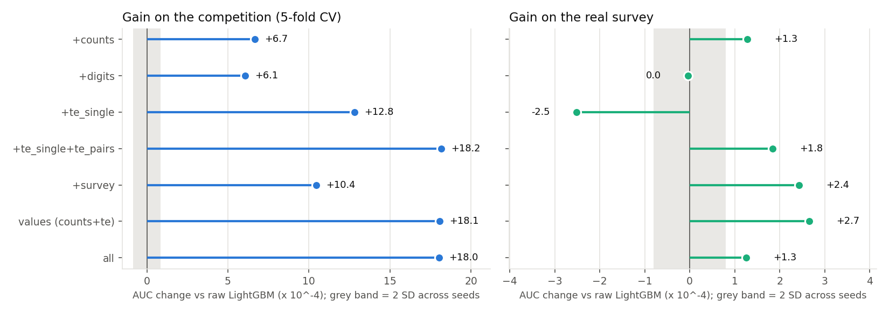

**English** | [Español](README.es.md)

# Airline satisfaction: a 0.961 leaderboard that is really a 0.994 model


Kaggle [Playground Series S6E10, Predicting Airline Satisfaction](https://www.kaggle.com/competitions/playground-series-s6e10):
699,635 passengers with a label, 299,844 to score, ranked by ROC AUC. The rows are
synthetic. They were generated from a real survey of 129,880 US airline passengers
([Airline Passenger Satisfaction](https://www.kaggle.com/datasets/teejmahal20/airline-passenger-satisfaction)).

I built the usual competition pipeline: boosted trees, a neural net, 5-fold CV, stacked blends.
Then I scored every model on the **real** survey too. The models are much better than the
leaderboard shows. A stack that scores 0.961 on the competition scores **0.994 on the real
passengers**, and that gap behaves like about 3% of the competition's labels being flipped at
random.

That real survey also gives a test that the leaderboard cannot. For every feature trick
I can ask whether its gain carries over to real passengers, or comes only from how the
synthetic rows were generated. Some of the popular tricks fail that test.

**Best Kaggle public score: 0.96055** (stack of five boosted models and a RealMLP; CV 0.96113).
Rank 1,179 of 2,924 teams on 2026-10-24. The leader is at 0.96407 and the median team at
0.95958.

**Project page:** https://rxyxs.github.io/airline-satisfaction-kaggle/

## Results

The first seven files came from one run and were submitted together. The last two (RealMLP
and the extended stack) were picked on CV and submitted together a few hours later. Nothing was
tuned on the leaderboard. "Real survey" means the 129,880 original passengers. The models never trained on
them, and each number is the average prediction of the five fold models.

| Submission | 5-fold CV | Kaggle public | Real survey |
|---|---|---|---|
| Logistic regression (one-hot, scaled) | 0.92156 | 0.92227 | 0.92000 |
| LightGBM, the 21 columns as given | 0.95884 | 0.95813 | 0.99300 |
| LightGBM + value features | 0.96064 | 0.96017 | 0.99327 |
| XGBoost (GPU) + value features | 0.96079 | 0.96037 | 0.99333 |
| CatBoost (GPU), every column also as a category | 0.96064* | 0.96038 | 0.99353 |
| RealMLP (GPU) + value features | 0.96051 | 0.95995 | 0.99331 |
| Rank mean of the four tree models | 0.96096* | 0.96029 | 0.99375 |
| Logistic stack of the four tree models | 0.96107* | 0.96051 | 0.99369 |
| **Logistic stack, extended** (four trees + RealMLP + LightGBM with every feature group) | **0.96113** | **0.96055** | 0.99376 |

Fold-to-fold standard deviation is 0.0004-0.0005 for every model. CV and the public
leaderboard agree to within 0.0007 and rank the models in nearly the same order.

\* CatBoost on GPU is not bit-reproducible. Rerunning the pipeline moved its CV from 0.96069
to 0.96064, and the blends that use it by 0.00001-0.00002. The Kaggle scores are for the files
from the first run. Every other model reproduces exactly.


## Findings

**1. The competition labels look about 3% noisier than the real ones.** A model trained only
on synthetic rows ranks real passengers almost as well (0.9937) as a LightGBM trained on the real
survey and scored on a held-out 20% of it (0.9950). The structure is in the synthetic
data. What caps the score is the labels. I flipped a random share of the real-survey labels and
re-scored the stack. With 3.0% flipped, its AUC on real passengers is 0.963. With 3.5%
flipped, it is 0.958. The competition CV of 0.961 lies between the two, so the synthetic labels
behave like **about 3% random flips**. Seen this way, the whole leaderboard is packed against a
noise floor. The top team is 0.0035 above my best submission and the median team 0.0010 below it.


**2. Some feature tricks help only on synthetic data.** Public notebooks for this competition
pile on features: exact values as categories, value counts, the digits of each number, rates
from the original survey. I added each group on its own to the raw-column LightGBM, on the same
folds, and scored every fold model twice. To know what counts as a real difference, I reran
three configurations with three more LightGBM seeds. The seed-to-seed standard deviation is
0.00004 on both scores. The table shows the seed-0 runs.

| Feature group added | Gain on competition CV | Gain on real survey |
|---|---|---|
| Value counts | +0.00067 | +0.00013 |
| Decimal digits of the four numbers | +0.00061 | 0.00000 |
| Target encoding of exact values | +0.00128 | **-0.00025** |
| Target encoding of values and all 210 column pairs | +0.00182 | +0.00018 |
| Satisfaction rate of each value and pair in the real survey | +0.00104 | +0.00024 |
| Counts + both target encodings (the "value" view) | +0.00181 | +0.00027 |
| All of the above | +0.00180 | +0.00013 |



- **Digits are a pure generator artifact.** The last digit of someone's flight distance tells
  you nothing about a real passenger. Averaged over four seeds, digits add +0.0005 on CV
  (about 12 seed standard deviations) and -0.00007 on the real survey (within 2).
- **Target-encoding exact values on its own hurts on real passengers.** It is the largest
  single-group gain on competition CV, and it makes the model worse on the real survey
  (-0.00027 averaged over four seeds, about 6 standard deviations). The model learns rates for
  individual ages and distances that the generator made up. Adding the column pairs turns the
  real-survey effect positive (+0.00018), so the combinations carry signal that transfers.
- **The real survey's own rates help in both places**, but less on the competition (+0.0010)
  than the encodings fitted on the competition's labels.
- **Stacking everything adds nothing.** The LightGBM with every group ties the value view on CV
  (0.96064) and is worse on the real survey (0.99313 vs 0.99327).

On the leaderboard, a trick that exploits the generator and one that captures passenger
behaviour look the same. Only the real survey can tell them apart.

**3. Adding the real survey as training rows does not help.** Appending all 129,880 original
passengers to every training fold moves CV from 0.95884 to 0.95866. The generator changed the
data enough that the real rows are a different distribution. 91% of synthetic passengers
left on time, against 56% in the survey. Late-flight satisfaction is lower in the synthetic
data (33% vs 38% for 16-60 minute delays), and the survey's "Inflight service" rating was dropped.
A model trained only on the survey scores 0.9549 on the competition rows, below every boosted
model trained on the competition rows themselves.


**4. A neural net brings diversity, not a better score.** RealMLP (pytabkit) on the value view
scores 0.96051 CV, close to the boosted models (0.96064-0.96079). Its out-of-fold predictions correlate 0.969-0.974
(Spearman) with the other value models, as low as CatBoost's 0.969-0.975 and below the two
value LightGBMs and XGBoost among themselves (0.983-0.984). The extended stack puts most of its
weight on those two (CatBoost 0.37, RealMLP 0.36). All this lifts the stack by 0.00006 CV and 0.00004 on the
leaderboard. Against a noise floor this close, extra models give almost nothing back.

**5. CV was a reliable guide.** Every model and blend lost 0.0003-0.0007 from CV to the
public leaderboard, so the gaps between them carried over. The rank mean and the four-tree stack differed by 0.0001
in CV and 0.0002 on the leaderboard, in the same direction. With 700k training rows, the
optimism from early stopping on the validation fold (standard for out-of-fold stacking) is small
and the same for every model.

## Method

- **Data** (`src/airline/data.py`): 21 features. 13 are 0-5 service ratings, plus age, flight distance,
  two delays (292 missing arrival delays, left as missing for the trees) and four text
  columns. The original survey is mapped to the same schema.
- **Folds**: one `StratifiedKFold(5, shuffle, seed 0)` shared by every model, the blends, the ablation and the
  study.
- **Value features** (`src/airline/features.py`): the frequency of each value over train+test
  (label-free), plus sklearn `TargetEncoder` (5-fold cross-fitting inside each training fold)
  on the 21 columns and all 210 column pairs as string keys. The encoder only ever sees the
  training part of the fold.
- **Models** (`src/airline/models.py`): early stopping on the validation fold (200 rounds; 300
  for CatBoost). LightGBM 63 leaves, lr 0.05. XGBoost depth 7 on CUDA. CatBoost depth 7 on GPU, with the 21 columns
  as categorical strings next to the four raw numeric columns. RealMLP: 512-256-128 SiLU,
  ensemble of 4, fixed 4 epochs (no early stopping).
- **Blends** (`src/airline/blend.py`): an unweighted rank mean, and a logistic regression on
  the models' logits. The stack's CV is itself cross-validated over the out-of-fold rows.
  Weights of the four-tree stack: CatBoost 0.40, XGBoost 0.28, LightGBM-values 0.28,
  LightGBM-raw 0.05. Extended stack: CatBoost 0.37, RealMLP 0.36, XGBoost 0.17,
  LightGBM-values 0.12, LightGBM-all 0.08, LightGBM-raw -0.01.
- **Ablation** (`src/airline/ablation.py`): one LightGBM per feature group on the shared folds,
  each scored on CV and on the real survey. The survey-rate group is computed out-of-fold
  inside the survey when the survey itself is scored, so no row sees its own label. Raw,
  exact-value encoding and digits are rerun with three more seeds.
- **Real-survey study** (`src/airline/study.py`): original-only training, original rows
  appended to every fold, distribution comparison, and the label-flip curve (5 random flips
  per rate, rates 0-8% in 0.5% steps).

## Reproduce

```bash
python -m venv venv && venv/Scripts/pip install -r requirements-nn.txt   # Windows path; requirements.txt alone skips RealMLP
# needs a Kaggle API key and the competition rules accepted
PYTHONPATH=src python -m airline.data      # downloads both datasets into data/
PYTHONPATH=src python -m airline.run       # 7 models x 5 folds (XGBoost, CatBoost, RealMLP use a GPU)
PYTHONPATH=src python -m airline.blend     # blends + submissions/*.csv
PYTHONPATH=src python -m airline.study     # real-survey study
PYTHONPATH=src python -m airline.ablation  # feature-group ablation (~75 min)
PYTHONPATH=src python -m airline.figures
PYTHONPATH=src python -m airline.submit stack   # optional
PYTHONPATH=src pytest -q tests
```

On an RTX 4060 Ti and a 16-thread CPU with nothing else running, the first five models take
about 37 minutes (LightGBM-raw 1.6 min, LightGBM-values 12.6, XGBoost 9.5, CatBoost 12.8). The
minutes in `reports/cv.json` come from the last rerun, which shared the machine with other
jobs. All metrics are in `reports/*.json`.

## Data and license

- Competition data: [playground-series-s6e10](https://www.kaggle.com/competitions/playground-series-s6e10),
  under the competition rules. It is not redistributed here (the CSVs are git-ignored).
  Downloaded 2026-10-23.
- Original survey: [teejmahal20/airline-passenger-satisfaction](https://www.kaggle.com/datasets/teejmahal20/airline-passenger-satisfaction),
  license listed as "other". Not redistributed. Downloaded 2026-10-23.
- `submissions/` (git-ignored) is rebuilt by `airline.blend`.
- Code: MIT, see [LICENSE](LICENSE).
